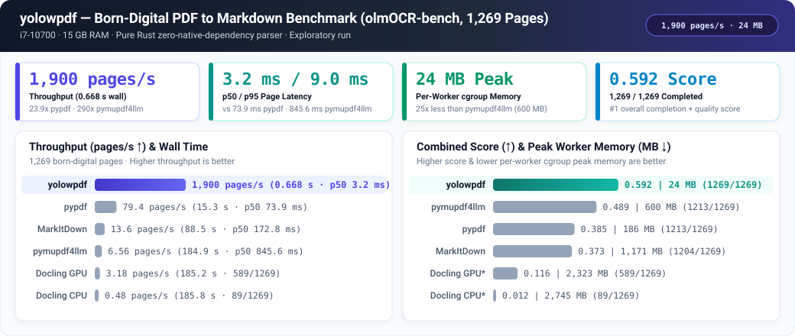
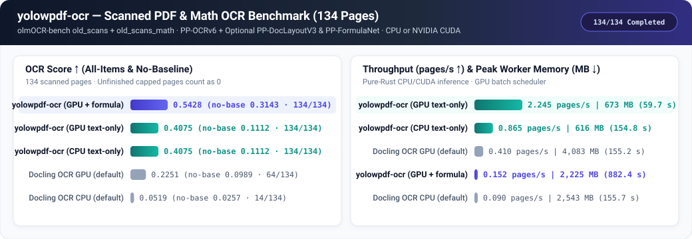
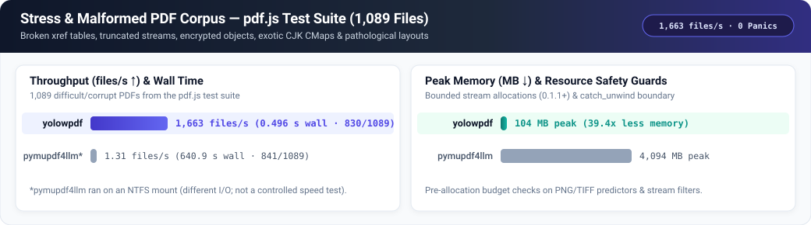
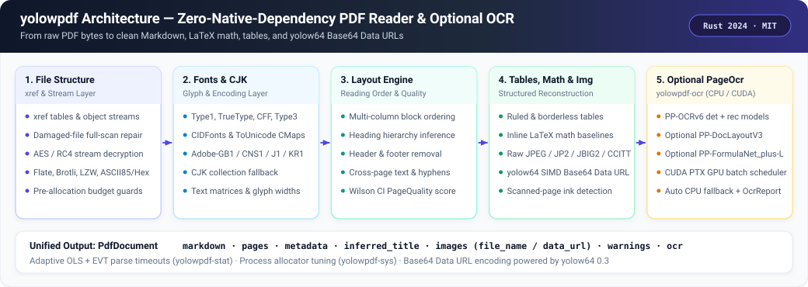

<div align="center">

# yolowpdf

**Zero-Native-Dependency PDF-to-Markdown Library & Pure-Rust OCR Engine**

[**English**](README.md) · [**简体中文**](docs/README.zh-CN.md) · [**API Reference**](docs/API.md) · [**Benchmarks**](benchmarks/README.md)

[](https://crates.io/crates/yolowpdf)
[](https://docs.rs/yolowpdf)
[](LICENSE)
[](Cargo.toml)

</div>

A PDF-to-Markdown library and OCR engine in Rust, extracted from [PageSift](https://github.com/YOLOW92/pagesift). It reads the PDF file format from the ground up: **no Poppler, MuPDF, PDFium, or other native C/C++ PDF library**.

<p align="center">
  
</p>

---

## At a Glance

- **`yolowpdf`**: PDF parsing, text extraction, layout reconstruction, tables, inline LaTeX formulas, zero-reencode image export, [`yolow64`](https://crates.io/crates/yolow64) SIMD Base64 Data URL generation (`PdfImage::data_url`), and scanned-page detection. **Zero model dependencies.**
- **`yolowpdf-ocr`**: PP-OCRv6 text detection and recognition, optional document layout (`PP-DocLayoutV3`) and formula recognition (`PP-FormulaNet`), running in pure Rust on CPU or an NVIDIA GPU.
- **Minimal API**: `extract`, `extract_with`, and the `PageOcr` trait.
- **Permissive & Self-Contained**: Runtime dependencies are permissive; the PDF core has no native library and no model runtime.
- **Toolbar & Toolchain**: Rust 1.89 or newer, edition 2024. MIT licensed (see [LICENSE](LICENSE), [THIRD-PARTY.md](THIRD-PARTY.md), and [UPSTREAM.md](UPSTREAM.md)).

## Story

PageSift is a crawler and content-extraction engine. Its PDF path began with a simple requirement: take a PDF found in the wild and return clean Markdown, without installing a native PDF stack on every machine.

The files were not clean. They had broken `xref` tables, object streams, encrypted streams, CID fonts without a `ToUnicode` map, multi-column layouts, tables, inline formulas, images, and scanned pages. Handling them grew into a standalone PDF reader: file structure, fonts, layout, tables, math, images, and a hook for OCR. Scanned pages then needed an OCR engine, which became the second crate.

That work became `yolowpdf`: the PDF reader and OCR engine extracted from PageSift 1.2.4 (commit `07a7053e`), now in an independent MIT-licensed workspace (and used upstream by PageSift as a dependency). The core handles documents with a text layer; the optional OCR crate gives scanned pages a path through the same interface. Neither a fast parse nor nonempty output guarantees that a difficult page was understood.

---

## Install

Published on crates.io:

```toml
[dependencies]
yolowpdf = "0.1.2"

# Optional OCR for scanned pages:
yolowpdf-ocr = "0.1"
```

---

## Usage

### 1. PDF to Markdown

```rust
fn main() -> Result<(), Box<dyn std::error::Error>> {
    let bytes = std::fs::read("document.pdf")?;
    let doc = yolowpdf::extract(&bytes)?;

    println!("{}", doc.markdown);
    println!("pages: {}", doc.pages.len());
    println!("scanned: {}", doc.scanned);
    Ok(())
}
```

### 2. With Resource Limits, Images, and Base64 Data URLs

```rust
use std::time::Duration;

let opts = yolowpdf::Options {
    timeout: Some(Duration::from_secs(30)),
    images: yolowpdf::ImageOptions {
        markdown: true,
        export: true, // export raw image bytes & enable Base64 data_url()
        ..Default::default()
    },
    ..Default::default()
};

let doc = yolowpdf::extract_with(&bytes, &opts)?;
for img in &doc.images {
    if let Some(uri) = img.data_url() {
        println!("{} ({}) -> {} chars", img.file_name(), img.mime_type(), uri.len());
    }
}
for warning in &doc.warnings {
    eprintln!("warning: {warning}");
}
```

`PdfDocument` exposes the whole Markdown, per-page Markdown, metadata, page quality, image references (`file_name()`, `mime_type()`, `data_url()`), document warnings, and an OCR report. `Error` is `Malformed`, `Encrypted`, `TooLarge`, or `Timeout`; a parser panic is caught and returned as an error instead of taking the caller down.

### 3. OCR for Scanned Pages

```rust
use std::sync::Arc;
use yolowpdf_ocr::device::Device;
use yolowpdf_ocr::pdf::PdfOcr;

let engine = Arc::new(PdfOcr::from_dirs(
    det_dir,          // PP-OCRv6 detection model
    rec_dir,          // PP-OCRv6 recognition model
    None,             // or Some((layout_dir, formula_dir))
    Device::Cpu,      // or Device::Gpu { index: 0 }
)?);

let opts = yolowpdf::Options {
    ocr: Some(engine),
    ..Default::default()
};

let doc = yolowpdf::extract_with(&bytes, &opts)?;
```

`PdfOcr::from_dirs` loads the supplied models immediately. `PdfOcr::new` with a configuration loads them on the first OCR request instead. A GPU that cannot start falls back to CPU and reports the reason. The model list, pinned revisions, and SHA-256 values are in `crates/yolowpdf-ocr/src/models.rs`; models are downloaded by the caller and are not bundled. See [`docs/API.md`](docs/API.md) for the full surface.

Concurrency is document-level: one `extract_with` call processes one document; run multiple calls on multiple threads or processes for throughput. The OCR engine has its own GPU batch scheduler, so several document workers can feed one GPU.

---

## Performance

These exploratory runs use public olmOCR-bench data on one machine (`i7-10700`, 15 GB RAM, `GTX 1070`). The target was 16 workers, but resource admission reduced actual concurrency for several tools; the formula run used 2. The tools have different features, startup, and I/O costs. A successful result means nonempty output, not necessarily correct extraction; placeholders can count. Peak MB is the largest per-worker cgroup memory peak, not total RSS.

Docling ran last with a time cap; unfinished pages count as failed tests. The reported scores combine completion and quality. Some scoring used an unverified math prefilter, so these are **not certified official scores**. A common-page quality comparison was not completed. See the [full report](benchmarks/results/2026-11-09/report.md) for actual workers, conditions, and raw results. Higher completion, throughput, and score are better; lower time and memory are better.

### 1. Born-Digital PDFs: olmOCR-bench (1,269 Pages)

| Tool | Completed ↑ | Wall s ↓ | Pages/s ↑ | p50 ms ↓ | p95 ms ↓ | Peak MB ↓ | Score ↑ |
|:---|---:|---:|---:|---:|---:|---:|---:|
| **yolowpdf** | **1269/1269** | **0.668** | **1,900** | **3.2** | **9.0** | **24** | **0.592** |
| pymupdf4llm | 1213/1269 | 184.933 | 6.56 | 845.6 | 1,980.5 | 600 | 0.489 |
| pypdf | 1213/1269 | 15.285 | 79.4 | 73.9 | 233.5 | 186 | 0.385 |
| MarkItDown | 1204/1269 | 88.469 | 13.6 | 172.8 | 518.2 | 1,171 | 0.373 |
| Docling GPU | 589/1269 | 185.150 | 3.18 | 364.2 | 1,823.8 | 2,323 | 0.116 |
| Docling CPU | 89/1269 | 185.840 | 0.48 | 1,317.1 | 12,149.1 | 2,745 | 0.012 |

Docling ran with a 184.933-second cap and two workers. Its GPU run averaged 75.0% GPU utilisation and 4,858 MiB of VRAM; its CPU run used two workers and no GPU. The all-items score counts capped pages as failures, so the Docling rows measure quality **and** completion together. They are not a claim that Docling's completed pages are that bad.

### 2. Scanned PDFs & Math OCR: `old_scans` + `old_scans_math` (134 Pages)

<p align="center">
  
</p>

| Tool | Mode | Completed ↑ | Wall s ↓ | Pages/s ↑ | Peak MB ↓ | Score ↑ | No-baseline ↑ |
|:---|:---|---:|---:|---:|---:|---:|---:|
| **yolowpdf-ocr** | GPU, layout + formula | **134/134** | 882.395 | 0.152 | 2,225 | **0.5428** | **0.3143** |
| **yolowpdf-ocr** | GPU, text only | **134/134** | **59.675** | **2.245** | 673 | 0.4075 | 0.1112 |
| **yolowpdf-ocr** | CPU, text only | **134/134** | 154.847 | 0.865 | **616** | 0.4075 | 0.1112 |
| Docling OCR GPU | default | 64/134 | 155.163 | 0.41 | 4,083 | 0.2251 | 0.0989 |
| Docling OCR CPU | default | 14/134 | 155.749 | 0.09 | 2,543 | 0.0519 | 0.0257 |

The formula-enabled run used a different time cap and two workers. It is not a controlled quality comparison with the capped Docling runs.

### 3. Stress & Hard PDFs: `pdf.js` Corpus (1,089 Files)

<p align="center">
  
</p>

| Tool | Completed ↑ | Wall s ↓ | Files/s ↑ | Peak MB ↓ |
|:---|---:|---:|---:|---:|
| **yolowpdf** | 830/1089 | **0.496** | **1,663** | **104** |
| pymupdf4llm | 841/1089 | 640.861 | 1.31 | 4,094 |

The `pymupdf4llm` `pdf.js` run used an NTFS mount; the runs had different I/O conditions and are not a controlled comparison.

---

## How It Works

<p align="center">
  
</p>

1. **File structure.** `xref` tables and streams, object streams, damaged-file repair, encryption, Flate/Brotli, JPEG, JPEG 2000, JBIG2, CCITT, PNG, TIFF, and WebP images.
2. **Fonts and text.** Type1, TrueType, CFF, Type3, CID fonts, `ToUnicode`, predefined CMaps, CJK collections without `ToUnicode`, glyph widths, and text matrices.
3. **Layout.** Paragraphs, headings, multi-column reading order, headers and footers, lists, figures, and page-quality checks.
4. **Tables, math, and images.** Ruled grids, booktabs-style rules, borderless alignment; inline math reconstructed as LaTeX from glyphs, fonts, sizes, and baselines; original-encoding image export and [`yolow64`](https://crates.io/crates/yolow64) SIMD Base64 Data URL encoding.
5. **OCR.** `PageOcr` is a trait in the core crate. `yolowpdf-ocr` implements it with PP-OCRv6, optional PP-DocLayoutV3 and PP-FormulaNet, CPU or CUDA, and automatic fallback with a reported reason.

The core crate never depends on a model runtime. The OCR crate is optional.

---

## Correctness and Limits

- Every input is bounded: input size, page count, decompressed stream size, and per-file time. `page_limit` processes only the first N pages.
- Stream filters (`ASCII85`, `ASCIIHex`, `RunLength`, `Crypt`, and `PNG`/`TIFF` predictors) verify output budgets before reserving or resizing buffers.
- Parser panics are caught in `extract_with`; malformed files return `Error`.
- Scanned-page detection and OCR status are reported in the returned document.
- OCR failures and partial OCR are attached to the returned document, not swallowed.
- `cargo test --release --workspace` covers parser, fonts, tables, OCR plumbing, stress cases, and fuzz regressions. Fuzz targets live in `crates/yolowpdf/fuzz`.
- `cargo fmt --check` and `cargo deny --config .github/deny.toml check` pass.

## Benchmarks

- Method and commands: [`benchmarks/README.md`](benchmarks/README.md).
- Tool versions and environments: [`benchmarks/tools.lock.md`](benchmarks/tools.lock.md).
- Raw results and full report: [`benchmarks/results/2026-11-09/`](benchmarks/results/2026-11-09/).
- SVG chart generator: [`benchmarks/figures/generate.py`](benchmarks/figures/generate.py).
- Data are downloaded, not redistributed: olmOCR-bench (ODC-BY 1.0, official scoring code Apache-2.0) and the `pdf.js` test corpus (Apache-2.0).

## Changelog

See [CHANGELOG.md](CHANGELOG.md).

## License

MIT. See [LICENSE](LICENSE). Third-party notices: [THIRD-PARTY.md](THIRD-PARTY.md). Upstream provenance: [UPSTREAM.md](UPSTREAM.md).
