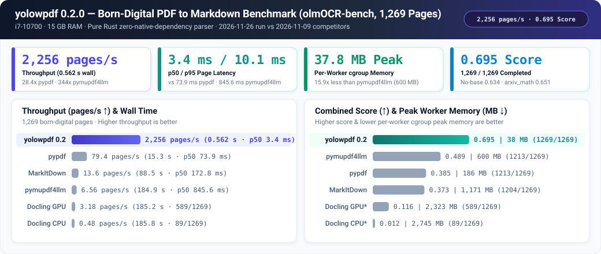
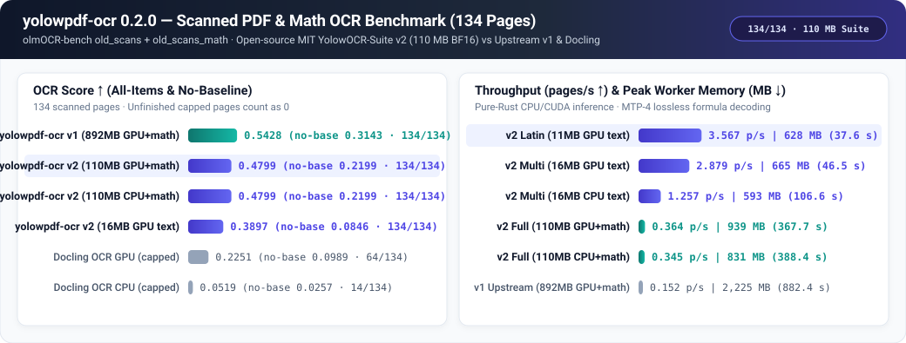
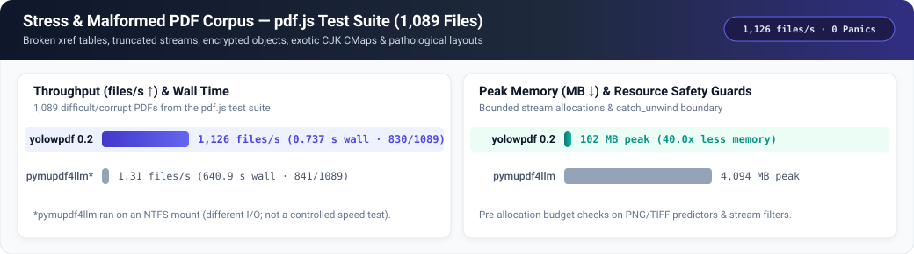
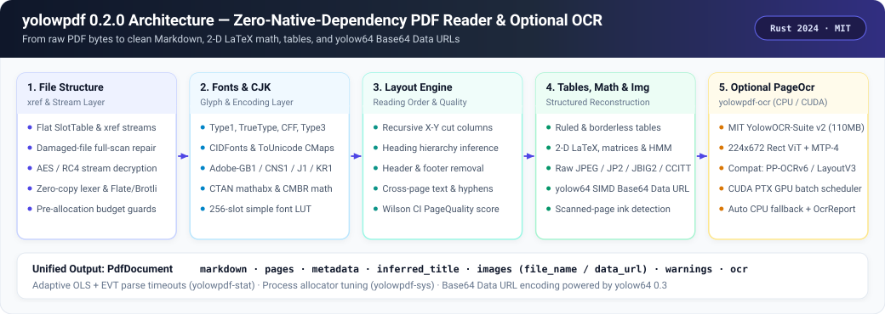

<div align="center">

# yolowpdf

**Zero-Native-Dependency PDF-to-Markdown Library & Pure-Rust OCR Engine**

[**English**](README.md) · [**简体中文**](docs/README.zh-CN.md) · [**API Reference**](docs/API.md) · [**Models (HF)**](https://huggingface.co/YOLOW92/yolowocr-v2) · [**Benchmarks**](benchmarks/README.md)

[](https://crates.io/crates/yolowpdf)
[](https://docs.rs/yolowpdf)
[](https://huggingface.co/YOLOW92/yolowocr-v2)
[](LICENSE)
[](Cargo.toml)

</div>

A PDF-to-Markdown library and OCR engine in Rust, extracted from [PageSift](https://github.com/YOLOW92/pagesift). It reads the PDF file format from the ground up: **no Poppler, MuPDF, PDFium, or other native C/C++ PDF library**.

<p align="center">
  
</p>

---

## At a Glance

- **`yolowpdf` (`0.2.0`)**: PDF parsing, text extraction, recursive X-Y cut multi-column layout reconstruction, tables, native 2-D LaTeX formulas & matrices (`pmatrix`/`cases`/`\binom` + HMM text/math segmentation), zero-reencode image export, [`yolow64`](https://crates.io/crates/yolow64) SIMD Base64 Data URL generation (`PdfImage::data_url`), and scanned-page detection. **Zero model dependencies.**
- **`yolowpdf-ocr` (`0.2.0`)**: Pure-Rust OCR on CPU or NVIDIA CUDA supporting both the open-source MIT [**`YolowOCR-Suite v2`**](https://huggingface.co/YOLOW92/yolowocr-v2) BF16 models (**109.6 MB** full suite: text detection, multilingual/Latin recognition, `640×640` layout, and `224×672` rectangular formula recognition with lossless MTP-4 self-speculative decoding) and upstream `PP-OCRv6` / `PP-DocLayoutV3` / `PP-FormulaNet_plus-L` safetensors.
- **Minimal API**: `extract`, `extract_with`, and the `PageOcr` trait.
- **Permissive & Self-Contained**: Runtime dependencies are permissive; the PDF core has no native library and no model runtime.
- **Toolchain & License**: Rust 1.89 or newer, edition 2024. MIT licensed (see [LICENSE](LICENSE), [THIRD-PARTY.md](THIRD-PARTY.md), and [UPSTREAM.md](UPSTREAM.md)).

## Story

PageSift is a crawler and content-extraction engine. Its PDF path began with a simple requirement: take a PDF found in the wild and return clean Markdown, without installing a native PDF stack on every machine.

The files were not clean. They had broken `xref` tables, object streams, encrypted streams, CID fonts without a `ToUnicode` map, multi-column layouts, tables, 2-D math formulas, images, and scanned pages. Handling them grew into a standalone PDF reader: file structure, fonts, layout, tables, math, images, and a hook for OCR. Scanned pages then needed an OCR engine, which became the second crate—now paired with our open-source MIT BF16 model suite on Hugging Face ([`YOLOW92/yolowocr-v2`](https://huggingface.co/YOLOW92/yolowocr-v2)).

That work became `yolowpdf`: the PDF reader and OCR engine extracted from PageSift 1.2.4 (commit `07a7053e`), now in an independent MIT-licensed workspace (and used upstream by PageSift as a dependency). The core handles documents with a text layer; the optional OCR crate gives scanned pages a path through the same interface. Neither a fast parse nor nonempty output guarantees that a difficult page was understood.

---

## Install

Published on crates.io:

```toml
[dependencies]
yolowpdf = "0.2"

# Optional OCR for scanned pages:
yolowpdf-ocr = "0.2"
```

---

## Open-Source Models (`YolowOCR-Suite v2`)

All five from-scratch BF16 safetensors models are open-sourced under the **MIT License** at [**`huggingface.co/YOLOW92/yolowocr-v2`**](https://huggingface.co/YOLOW92/yolowocr-v2) (**109.6 MB** full multilingual suite / **105.1 MB** Latin suite — **8.1× smaller** than the 892 MB upstream FP32 reference stack):

| Model Directory | Task | Input | Size (BF16) | Notes |
|---|---|---|---:|---|
| `det_v2/` | Text Detection | Dynamic (min 736) | **5.05 MB** | LCNetV4 + RepLKFPN + DB Head |
| `rec_v2_multi/` | Multilingual Recognition | `3×48×W` | **10.74 MB** | LCNetV4 + SVTR + CTC (18,710 vocab) |
| `rec_v2_latin/` | Fast Latin/English Recognition | `3×48×W` | **6.24 MB** | LCNetV4 + SVTR + CTC (254 vocab) |
| `layout_s_v2/` | Document Layout | `640×640` | **26.81 MB** | HGNetV2 + 1L HybridEncoder + 3L 150-Query Decoder |
| `formula_v2_rect_mtp/` | LaTeX Formula Recognition | `224×672` | **66.99 MB** | 8L Rect SAM-ViT + 6L Decoder + lossless MTP-4 (~3.1–3.5 ms/tok CPU) |

```bash
huggingface-cli download YOLOW92/yolowocr-v2 --local-dir ./yolowocr-v2
```

Pinned revisions, file sizes, and SHA-256 digests for both `YolowOCR-Suite v2` (`V2_DET`, `V2_REC_MULTI`, `V2_REC_LATIN`, `V2_LAYOUT`, `V2_FORMULA`) and upstream `PP-OCRv6` / `PP-DocLayoutV3` / `PP-FormulaNet_plus-L` live in `crates/yolowpdf-ocr/src/models.rs`.

---

## Usage

### 1. PDF to Markdown

```rust
fn main() -> Result<(), Box<dyn std::error::Error>> {
    let bytes = std::fs::read("document.pdf")?;
    let doc = yolowpdf::extract(&bytes)?;

    println!("{}", doc.markdown);
    println!("pages: {}", doc.pages.len());
    println!("scanned: {}", doc.scanned);
    Ok(())
}
```

### 2. With Resource Limits, Images, and Base64 Data URLs

```rust
use std::time::Duration;

let opts = yolowpdf::Options {
    timeout: Some(Duration::from_secs(30)),
    images: yolowpdf::ImageOptions {
        markdown: true,
        export: true, // export raw image bytes & enable Base64 data_url()
        ..Default::default()
    },
    ..Default::default()
};

let doc = yolowpdf::extract_with(&bytes, &opts)?;
for img in &doc.images {
    if let Some(uri) = img.data_url() {
        println!("{} ({}) -> {} chars", img.file_name(), img.mime_type(), uri.len());
    }
}
for warning in &doc.warnings {
    eprintln!("warning: {warning}");
}
```

`PdfDocument` exposes the whole Markdown, per-page Markdown, metadata, page quality, image references (`file_name()`, `mime_type()`, `data_url()`), document warnings, and an OCR report. `Error` is `Malformed`, `Encrypted`, `TooLarge`, or `Timeout`; a parser panic is caught and returned as an error instead of taking the caller down.

### 3. OCR for Scanned Pages

```rust
use std::sync::Arc;
use yolowpdf_ocr::device::Device;
use yolowpdf_ocr::pdf::PdfOcr;

let engine = Arc::new(PdfOcr::from_dirs(
    "yolowocr-v2/det_v2".into(),       // or PP-OCRv6 detection model
    "yolowocr-v2/rec_v2_multi".into(), // or rec_v2_latin / PP-OCRv6 rec
    Some((
        "yolowocr-v2/layout_s_v2".into(),
        "yolowocr-v2/formula_v2_rect_mtp".into(),
    )),                                // or None for text-only OCR
    Device::Cpu,                       // or Device::Gpu { index: 0 }
)?);

let opts = yolowpdf::Options {
    ocr: Some(engine),
    ..Default::default()
};

let doc = yolowpdf::extract_with(&bytes, &opts)?;
```

`PdfOcr::from_dirs` loads the supplied models immediately. `PdfOcr::new` with a configuration loads them on the first OCR request instead. A GPU that cannot start falls back to CPU and reports the reason. Models are downloaded by the caller and are not bundled. See [`docs/API.md`](docs/API.md) for the full surface.

Concurrency is document-level: one `extract_with` call processes one document; run multiple calls on multiple threads or processes for throughput. The OCR engine has its own GPU batch scheduler, so several document workers can feed one GPU.

---

## Performance

These exploratory runs use public olmOCR-bench data on one machine (`i7-10700`, 15 GB RAM, `GTX 1070`). The target was 16 workers, with cgroup memory admission controlling live concurrency (`yolowpdf-ocr` GPU modes capped at 4 workers). `yolowpdf` 0.2.0 and `YolowOCR-Suite v2` rows are from the [2026-11-26 run](benchmarks/results/2026-11-26/report.md); competitor and v1 upstream reference rows are from the [2026-11-09 run](benchmarks/results/2026-11-09/report.md) on the same machine. A successful result means nonempty output, not necessarily correct extraction. Peak MB is the largest per-worker cgroup memory peak, not total RSS.

Docling ran last with a time cap; unfinished pages count as failed tests, so its reported scores combine completion and quality. Scoring used `YOLOWPDF_FAST_MATH=1` (an unverified math prefilter), so these are **not certified official scores**. Higher completion, throughput, and score are better; lower time and memory are better.

### 1. Born-Digital PDFs: olmOCR-bench (1,269 Pages, 7,295 Tests)

| Tool | Completed ↑ | Wall s ↓ | Pages/s ↑ | p50 ms ↓ | p95 ms ↓ | Peak MB ↓ | Score ↑ | No-baseline ↑ |
|:---|---:|---:|---:|---:|---:|---:|---:|---:|
| **yolowpdf 0.2.0** | **1269/1269** | **0.562** | **2,256** | **3.4** | **10.1** | **37.8** | **0.695** | **0.634** |
| yolowpdf 0.1.2 (2026-11-09) | 1269/1269 | 0.668 | 1,900 | 3.2 | 9.0 | 24.0 | 0.592 | 0.510 |
| pymupdf4llm | 1213/1269 | 184.933 | 6.56 | 845.6 | 1,980.5 | 600 | 0.489 | 0.396 |
| pypdf | 1213/1269 | 15.285 | 79.4 | 73.9 | 233.5 | 186 | 0.385 | 0.271 |
| MarkItDown | 1204/1269 | 88.469 | 13.6 | 172.8 | 518.2 | 1,171 | 0.373 | 0.258 |
| Docling GPU (capped) | 589/1269 | 185.150 | 3.18 | 364.2 | 1,823.8 | 2,323 | 0.116 | 0.046 |
| Docling CPU (capped) | 89/1269 | 185.840 | 0.48 | 1,317.1 | 12,149.1 | 2,745 | 0.012 | 0.000 |

In 0.2.0, `yolowpdf`'s `arxiv_math` pass rate rose from `0.0881` to **`0.6505`**, `multi_column` from `0.6821` to **`0.7161`**, and `long_tiny_text` from `0.4525` to **`0.4796`** (`table_tests` `0.5930`, `headers_footers` `0.7316`, `baseline` `0.9992`).

### 2. Scanned PDFs & Math OCR: `old_scans` + `old_scans_math` (134 Pages, 1,118 Tests)

<p align="center">
  
</p>

| Tool | Models & Mode | Completed ↑ | Wall s ↓ | Pages/s ↑ | Peak MB ↓ | Score ↑ | No-baseline ↑ |
|:---|:---|---:|---:|---:|---:|---:|---:|
| **yolowpdf-ocr 0.2** | **v2 Latin (11 MB), GPU text** | **134/134** | **37.562** | **3.567** | 628 | 0.3891 | 0.0837 |
| **yolowpdf-ocr 0.2** | **v2 Multi (16 MB), GPU text** | **134/134** | 46.548 | 2.879 | 665 | 0.3897 | 0.0846 |
| **yolowpdf-ocr 0.2** | **v2 Multi (16 MB), CPU text** | **134/134** | 106.580 | 1.257 | **593** | 0.3897 | 0.0846 |
| **yolowpdf-ocr 0.2** | **v2 Full (110 MB), GPU + math** | **134/134** | 367.664 | 0.364 | 939 | **0.4799** | **0.2199** |
| **yolowpdf-ocr 0.2** | **v2 Full (110 MB), CPU + math** | **134/134** | 388.367 | 0.345 | 831 | **0.4799** | **0.2199** |
| yolowpdf-ocr (v1 ref) | Upstream (892 MB), GPU + math | 134/134 | 882.395 | 0.152 | 2,225 | 0.5428 | 0.3143 |
| yolowpdf-ocr (v1 ref) | Upstream (31 MB), GPU text | 134/134 | 59.675 | 2.245 | 673 | 0.4075 | 0.1112 |
| Docling OCR GPU (capped) | default (cap 154.8 s) | 64/134 | 155.163 | 0.410 | 4,083 | 0.2251 | 0.0989 |
| Docling OCR CPU (capped) | default (cap 154.8 s) | 14/134 | 155.749 | 0.090 | 2,543 | 0.0519 | 0.0257 |

Compared to the 892 MB upstream FP32 reference stack, the 110 MB MIT `YolowOCR-Suite v2` stack runs **2.40× faster** with layout + formula on GPU (367.7 s vs 882.4 s) and uses **58% less** peak worker memory (939 MB vs 2,225 MB); even CPU-only v2 with layout + formula (388.4 s, 831 MB) is **2.27× faster** than v1 GPU. The accuracy difference (`0.4799` vs `0.5428`) is measured and documented in [benchmarks/results/2026-11-26/report.md](benchmarks/results/2026-11-26/report.md); users who prioritize maximum accuracy over footprint can pass upstream `PP-OCRv6` / `PP-DocLayoutV3` / `PP-FormulaNet_plus-L` directories to the same `PdfOcr::from_dirs` API.

### 3. Stress & Hard PDFs: `pdf.js` Corpus (1,089 Files)

<p align="center">
  
</p>

| Tool | Completed ↑ | Wall s ↓ | Files/s ↑ | p50 ms ↓ | Peak MB ↓ |
|:---|---:|---:|---:|---:|---:|
| **yolowpdf 0.2.0** (median of 3) | 830/1089 | **0.737** | **1,126** | **0.2** | **102** |
| yolowpdf 0.1.2 (2026-11-09, median of 3) | 830/1089 | 0.496 | 1,663 | 0.8 | 104 |
| pymupdf4llm | 841/1089 | 640.861 | 1.31 | 445.3 | 4,094 |

The `pymupdf4llm` `pdf.js` run used an NTFS mount; the runs had different I/O conditions and are not a controlled comparison.

---

## How It Works

<p align="center">
  
</p>

1. **File structure.** Flat direct-indexed `SlotTable`, `xref` tables and streams, object streams, damaged-file repair, encryption, zero-copy lexer, Flate/Brotli, JPEG, JPEG 2000, JBIG2, CCITT, PNG, TIFF, and WebP images.
2. **Fonts and text.** Type1, TrueType, CFF, Type3, CID fonts, `ToUnicode`, predefined CMaps, CJK collections without `ToUnicode`, CTAN `mathabx` / `CMBR*` math font support, glyph widths, and text matrices.
3. **Layout.** Paragraphs, headings, recursive X-Y cut multi-column reading order, headers and footers, lists, figures, and page-quality checks.
4. **Tables, math, and images.** Ruled grids, booktabs-style rules, borderless alignment; native 2-D LaTeX formula, fraction, radical, matrix, and binomial reconstruction with Viterbi HMM prose/math segmentation; original-encoding image export and [`yolow64`](https://crates.io/crates/yolow64) SIMD Base64 Data URL encoding.
5. **OCR.** `PageOcr` is a trait in the core crate. `yolowpdf-ocr` implements it in pure Rust with MIT-licensed [`YolowOCR-Suite v2`](https://huggingface.co/YOLOW92/yolowocr-v2) (BF16, rectangular ViT + MTP-4 speculative decoding) or upstream `PP-OCRv6` / `PP-DocLayoutV3` / `PP-FormulaNet_plus-L`, on CPU or CUDA with automatic fallback.

The core crate never depends on a model runtime. The OCR crate is optional.

---

## Correctness and Limits

- Every input is bounded: input size, page count, decompressed stream size, and per-file time. `page_limit` processes only the first N pages.
- Stream filters (`ASCII85`, `ASCIIHex`, `RunLength`, `Crypt`, and `PNG`/`TIFF` predictors) verify output budgets before reserving or resizing buffers.
- Parser panics are caught in `extract_with`; malformed files return `Error`.
- Scanned-page detection and OCR status are reported in the returned document.
- OCR failures and partial OCR are attached to the returned document, not swallowed.
- `cargo test --release --workspace` covers parser, fonts, tables, 2-D math, OCR plumbing, MTP speculative decoding parity, stress cases, and fuzz regressions. Fuzz targets live in `crates/yolowpdf/fuzz`.
- `cargo fmt --check` and `cargo deny --config .github/deny.toml check` pass.

## Benchmarks

- Method and commands: [`benchmarks/README.md`](benchmarks/README.md).
- Tool versions and environments: [`benchmarks/tools.lock.md`](benchmarks/tools.lock.md).
- Latest 0.2.0 / v2 results and report: [`benchmarks/results/2026-11-26/`](benchmarks/results/2026-11-26/report.md).
- Prior 0.1.2 / competitor baseline results: [`benchmarks/results/2026-11-09/`](benchmarks/results/2026-11-09/report.md).
- SVG chart generator: [`benchmarks/figures/generate.py`](benchmarks/figures/generate.py).
- Data are downloaded, not redistributed: olmOCR-bench (ODC-BY 1.0, official scoring code Apache-2.0) and the `pdf.js` test corpus (Apache-2.0).

## Changelog

See [CHANGELOG.md](CHANGELOG.md).

## License

MIT. See [LICENSE](LICENSE). Third-party notices: [THIRD-PARTY.md](THIRD-PARTY.md). Upstream provenance: [UPSTREAM.md](UPSTREAM.md).
