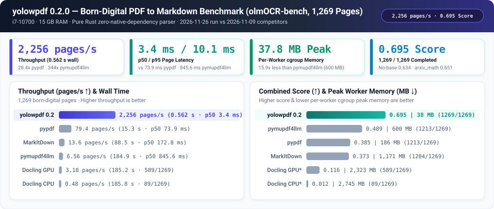
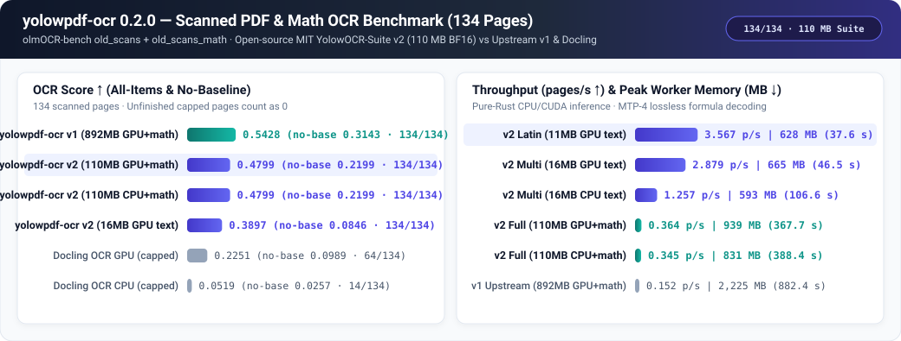
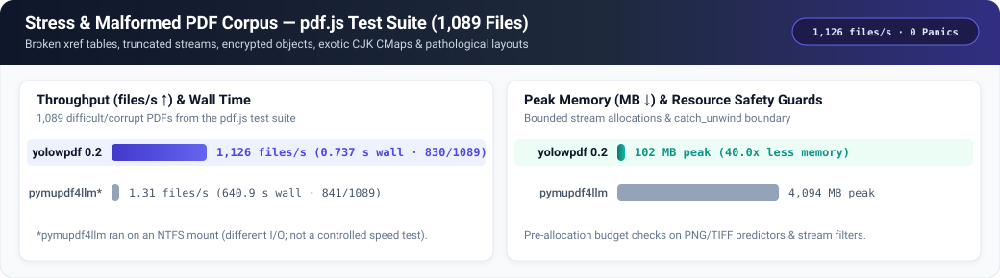
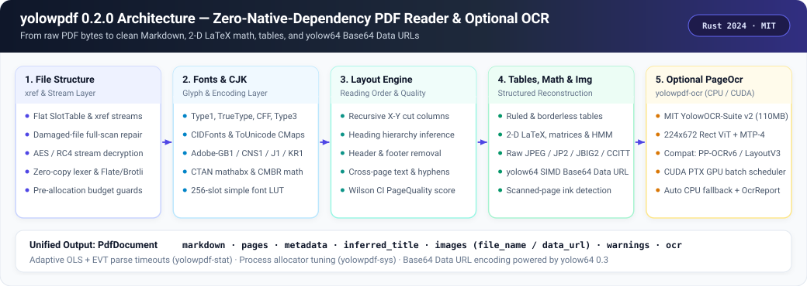

<div align="center">

# yolowpdf

**零原生依赖的 Rust PDF → Markdown 解析库与纯 Rust OCR 引擎**

[**English**](../README.md) · [**简体中文**](README.zh-CN.md) · [**API 参考**](API.md) · [**开源模型 (HF)**](https://huggingface.co/YOLOW92/yolowocr-v2) · [**基准测试**](../benchmarks/README.md)

[](https://crates.io/crates/yolowpdf)
[](https://docs.rs/yolowpdf)
[](https://huggingface.co/YOLOW92/yolowocr-v2)
[](../LICENSE)
[](../Cargo.toml)

</div>

用 Rust 编写的 PDF → Markdown 库与 OCR 引擎，从 [PageSift](https://github.com/YOLOW92/pagesift) 提取而来。它直接从底层读取 PDF 文件格式：**不依赖 Poppler、MuPDF、PDFium 或任何其他本地 C/C++ PDF 库**。

<p align="center">
  
</p>

---

## 一眼看过

- **`yolowpdf`（`0.2.0`）**：PDF 解析、文字提取、递归 X-Y 切分多栏版面重建、表格、原生二维 LaTeX 公式与矩阵重建（`pmatrix`/`cases`/`\binom` + Viterbi HMM 文本/公式切分）、原编码无损图片导出、基于 [`yolow64`](https://crates.io/crates/yolow64) 的 SIMD Base64 Data URL 编码（`PdfImage::data_url`）以及扫描页检测。**不依赖任何模型**。
- **`yolowpdf-ocr`（`0.2.0`）**：在 CPU 或 NVIDIA CUDA 上纯 Rust 运行的扫描页 OCR 引擎，原生支持 MIT 开源自研模型套件 [**`YolowOCR-Suite v2`**](https://huggingface.co/YOLOW92/yolowocr-v2)（全套 BF16 仅 **109.6 MB**：文字检测、多语/英文识别、`640×640` 版面分析以及 `224×672` 矩形公式识别 + 无损 MTP-4 自投机解码），同时完全兼容上游 `PP-OCRv6` / `PP-DocLayoutV3` / `PP-FormulaNet_plus-L` 权重。
- **精简 API**：`extract`、`extract_with`，以及 `PageOcr` trait。
- **宽松许可证且自包含**：运行时依赖均为宽松许可证；PDF 核心没有本地库，也没有模型运行时。
- **工具链与授权**：Rust 1.89 或更新，edition 2024。MIT 许可证（见 [LICENSE](../LICENSE)、[THIRD-PARTY.md](../THIRD-PARTY.md)、[UPSTREAM.md](../UPSTREAM.md)）。

## 故事

PageSift 是一个抓取和正文抽取引擎。它的 PDF 分支一开始只有一个要求：把互联网上拿到的 PDF 变成干净的 Markdown，不要让每台机器都装一套本地 PDF 工具链。

真实文件并不干净：坏的 `xref`、对象流、加密流、没有 `ToUnicode` 的 CID 字体、多栏排版、表格、二维数学公式、图片、扫描页。处理这些问题最后长成了一个独立的 PDF 阅读器：文件结构、字体、版面、表格、公式、图片，再留一个 OCR 接口。扫描页又需要 OCR，于是有了第二个 crate，并在 `0.2.0` 中配套开源了从零训练的 MIT 协议 BF16 模型套件（[`YOLOW92/yolowocr-v2`](https://huggingface.co/YOLOW92/yolowocr-v2)）。

这份代码从 PageSift 1.2.4（提交 `07a7053e`）提取出来，由版权持有人以 MIT 重新授权，成为独立的 `yolowpdf` 工作区（并作为上游依赖供 PageSift 使用）。核心处理带文字层的文档；可选 OCR crate 让扫描页通过同一接口进入处理流程。解析快或输出非空，并不意味着困难页面一定被正确理解。

---

## 安装

已发布到 crates.io：

```toml
[dependencies]
yolowpdf = "0.2"

# 可选扫描页 OCR：
yolowpdf-ocr = "0.2"
```

---

## 开源模型套件（`YolowOCR-Suite v2`）

全套 5 个从零训练的 BF16 safetensors 模型已按 **MIT 许可证**开源发布至 [**`huggingface.co/YOLOW92/yolowocr-v2`**](https://huggingface.co/YOLOW92/yolowocr-v2)（全套多语仅 **109.6 MB** / 英文轻量版 **105.1 MB**，比上游 892 MB FP32 模型组缩小 **8.1×**）：

| 模型目录 | 任务 | 输入尺寸 | 体积（BF16） | 说明 |
|---|---|---|---:|---|
| `det_v2/` | 文字检测 | 动态（短边 736） | **5.05 MB** | LCNetV4 + RepLKFPN + DB Head |
| `rec_v2_multi/` | 多语种文字识别 | `3×48×W` | **10.74 MB** | LCNetV4 + SVTR + CTC（18,710 字符表） |
| `rec_v2_latin/` | 英文/拉丁轻量识别 | `3×48×W` | **6.24 MB** | LCNetV4 + SVTR + CTC（254 字符表） |
| `layout_s_v2/` | 版面分析 | `640×640` | **26.81 MB** | HGNetV2 + 1 层混合编码器 + 3 层 150 查询解码器 |
| `formula_v2_rect_mtp/` | LaTeX 公式识别 | `224×672` | **66.99 MB** | 8 层矩形 SAM-ViT + 6 层解码器 + 无损 MTP-4（CPU ~3.1–3.5 ms/token） |

```bash
huggingface-cli download YOLOW92/yolowocr-v2 --local-dir ./yolowocr-v2
```

`YolowOCR-Suite v2`（`V2_DET`、`V2_REC_MULTI`、`V2_REC_LATIN`、`V2_LAYOUT`、`V2_FORMULA`）及上游 `PP-OCRv6` / `PP-DocLayoutV3` / `PP-FormulaNet_plus-L` 的锁定提交号、文件大小和 SHA-256 均已内置于 `crates/yolowpdf-ocr/src/models.rs`。

---

## 用法

### 1. PDF 转 Markdown

```rust
fn main() -> Result<(), Box<dyn std::error::Error>> {
    let bytes = std::fs::read("document.pdf")?;
    let doc = yolowpdf::extract(&bytes)?;

    println!("{}", doc.markdown);
    println!("页数: {}", doc.pages.len());
    println!("扫描件: {}", doc.scanned);
    Ok(())
}
```

### 2. 带资源限制、图片导出与 Base64 Data URL

```rust
use std::time::Duration;

let opts = yolowpdf::Options {
    timeout: Some(Duration::from_secs(30)),
    images: yolowpdf::ImageOptions {
        markdown: true,
        export: true, // 导出原编码图片字节并支持生成 Base64 data_url()
        ..Default::default()
    },
    ..Default::default()
};

let doc = yolowpdf::extract_with(&bytes, &opts)?;
for img in &doc.images {
    if let Some(uri) = img.data_url() {
        println!("{} ({}) -> {} chars", img.file_name(), img.mime_type(), uri.len());
    }
}
for warning in &doc.warnings {
    eprintln!("warning: {warning}");
}
```

`PdfDocument` 给出整篇 Markdown、逐页 Markdown、元数据、页质量、图片引用（`file_name()`、`mime_type()`、`data_url()`）、文档警告和 OCR 报告。`Error` 有 `Malformed`、`Encrypted`、`TooLarge`、`Timeout`；解析器 panic 会被接住并作为错误返回，不会带崩调用方。

### 3. 扫描页 OCR

```rust
use std::sync::Arc;
use yolowpdf_ocr::device::Device;
use yolowpdf_ocr::pdf::PdfOcr;

let engine = Arc::new(PdfOcr::from_dirs(
    "yolowocr-v2/det_v2".into(),       // 或 PP-OCRv6 检测模型目录
    "yolowocr-v2/rec_v2_multi".into(), // 或 rec_v2_latin / PP-OCRv6 识别模型目录
    Some((
        "yolowocr-v2/layout_s_v2".into(),
        "yolowocr-v2/formula_v2_rect_mtp".into(),
    )),                                // 或 None（仅文字 OCR）
    Device::Cpu,                       // 或 Device::Gpu { index: 0 }
)?);

let opts = yolowpdf::Options {
    ocr: Some(engine),
    ..Default::default()
};

let doc = yolowpdf::extract_with(&bytes, &opts)?;
```

`PdfOcr::from_dirs` 会立即加载指定模型；使用配置创建的 `PdfOcr::new` 则在首次 OCR 请求时加载。GPU 打不开时退回 CPU，并带回原因。模型由调用方下载，不随仓库分发。完整接口见 [`docs/API.md`](API.md)。

并发是文档级的：一次 `extract_with` 处理一份文档；要吞吐就多线程/多进程跑多份。OCR 引擎内部有 GPU 批调度，多个文档 worker 可以喂同一张卡。

---

## 性能

以下是公开 olmOCR-bench 数据上的探索性测试，机器为 `i7-10700`、15 GB 内存、`GTX 1070`。目标是 16 个 worker，并由 cgroup 内存准入动态控制并发（`yolowpdf-ocr` GPU 模式上限 4 worker）。`yolowpdf 0.2.0` 与 `YolowOCR-Suite v2` 数据来自 [2026-11-26 实测报告](../benchmarks/results/2026-11-26/report.md)；竞品与 v1 上游参考行引用同机的 [2026-11-09 报告](../benchmarks/results/2026-11-09/report.md)。完成仅表示输出非空，不等于识别正确。峰值内存是单 worker 的 cgroup 峰值，不是进程总 RSS。

Docling 受时间上限截断，未完成页面在评分时计失败，分数混合了质量和完成率。评分使用 `YOLOWPDF_FAST_MATH=1`（尚未验证严格等价性的公式预筛），**不能称为严格官方分**。完成数、吞吐和分数越高越好，时间和内存越低越好。

### 1. PDF：olmOCR-bench（1,269 页电子版，7,295 项测试）

| 工具 | 完成 ↑ | wall ↓ | 页/s ↑ | p50 ↓ | p95 ↓ | 峰值内存 ↓ | 评分 ↑ | 不含 baseline ↑ |
|:---|---:|---:|---:|---:|---:|---:|---:|---:|
| **yolowpdf 0.2.0** | **1269/1269** | **0.562 s** | **2,256** | **3.4 ms** | **10.1 ms** | **37.8 MB** | **0.695** | **0.634** |
| yolowpdf 0.1.2（2026-11-09） | 1269/1269 | 0.668 s | 1,900 | 3.2 ms | 9.0 ms | 24.0 MB | 0.592 | 0.510 |
| pymupdf4llm | 1213/1269 | 184.933 s | 6.56 | 845.6 ms | 1,980.5 ms | 600 MB | 0.489 | 0.396 |
| pypdf | 1213/1269 | 15.285 s | 79.4 | 73.9 ms | 233.5 ms | 186 MB | 0.385 | 0.271 |
| MarkItDown | 1204/1269 | 88.469 s | 13.6 | 172.8 ms | 518.2 ms | 1,171 MB | 0.373 | 0.258 |
| Docling GPU（截断） | 589/1269 | 185.150 s | 3.18 | 364.2 ms | 1,823.8 ms | 2,323 MB | 0.116 | 0.046 |
| Docling CPU（截断） | 89/1269 | 185.840 s | 0.48 | 1,317.1 ms | 12,149.1 ms | 2,745 MB | 0.012 | 0.000 |

0.2.0 中 `yolowpdf` 的 `arxiv_math` 通过率由 `0.0881` 升至 **`0.6505`**，`multi_column` 由 `0.6821` 升至 **`0.7161`**，`long_tiny_text` 由 `0.4525` 升至 **`0.4796`**（`table_tests` `0.5930`、`headers_footers` `0.7316`、`baseline` `0.9992`）。

### 2. OCR：olmOCR-bench `old_scans` + `old_scans_math`（134 页，1,118 项测试）

<p align="center">
  
</p>

| 工具 | 模型与模式 | 完成 ↑ | wall ↓ | 页/s ↑ | 峰值内存 ↓ | 评分 ↑ | 不含 baseline ↑ |
|:---|:---|---:|---:|---:|---:|---:|---:|
| **yolowpdf-ocr 0.2** | **v2 英文（11 MB），GPU 纯文字** | **134/134** | **37.562 s** | **3.567** | 628 MB | 0.3891 | 0.0837 |
| **yolowpdf-ocr 0.2** | **v2 多语（16 MB），GPU 纯文字** | **134/134** | 46.548 s | 2.879 | 665 MB | 0.3897 | 0.0846 |
| **yolowpdf-ocr 0.2** | **v2 多语（16 MB），CPU 纯文字** | **134/134** | 106.580 s | 1.257 | **593 MB** | 0.3897 | 0.0846 |
| **yolowpdf-ocr 0.2** | **v2 全套（110 MB），GPU + 公式** | **134/134** | 367.664 s | 0.364 | 939 MB | **0.4799** | **0.2199** |
| **yolowpdf-ocr 0.2** | **v2 全套（110 MB），CPU + 公式** | **134/134** | 388.367 s | 0.345 | 831 MB | **0.4799** | **0.2199** |
| yolowpdf-ocr（v1 参考） | 上游（892 MB），GPU + 公式 | 134/134 | 882.395 s | 0.152 | 2,225 MB | 0.5428 | 0.3143 |
| yolowpdf-ocr（v1 参考） | 上游（31 MB），GPU 纯文字 | 134/134 | 59.675 s | 2.245 | 673 MB | 0.4075 | 0.1112 |
| Docling OCR GPU（截断） | 默认（上限 154.8 s） | 64/134 | 155.163 s | 0.410 | 4,083 MB | 0.2251 | 0.0989 |
| Docling OCR CPU（截断） | 默认（上限 154.8 s） | 14/134 | 155.749 s | 0.090 | 2,543 MB | 0.0519 | 0.0257 |

相比 892 MB 上游 FP32 参考模型组，110 MB 的 MIT 开源 `YolowOCR-Suite v2` 在 GPU 含版面与公式模式下提速 **2.40×**（367.7 s vs 882.4 s）、单 worker 峰值内存降低 **58%**（939 MB vs 2,225 MB）；纯 CPU 含公式模式（388.4 s，831 MB）也比上一代 GPU 含公式快 **2.27×**。两者得分差异（`0.4799` vs `0.5428`）的逐项归因记录在 [2026-11-26 报告](../benchmarks/results/2026-11-26/report.md)；若更看重最高分数而非体积与速度，可直接将上游 `PP-OCRv6` / `PP-DocLayoutV3` / `PP-FormulaNet_plus-L` 目录传给同一 `PdfOcr::from_dirs` 接口。

### 3. 难题 PDF：`pdf.js` 语料库（1,089 份）

<p align="center">
  
</p>

| 工具 | 完成 ↑ | wall ↓ | 份/s ↑ | p50 ↓ | 峰值内存 ↓ |
|:---|---:|---:|---:|---:|---:|
| **yolowpdf 0.2.0**（3 轮中位） | 830/1089 | **0.737 s** | **1,126** | **0.2 ms** | **102 MB** |
| yolowpdf 0.1.2（2026-11-09，3 轮中位） | 830/1089 | 0.496 s | 1,663 | 0.8 ms | 104 MB |
| pymupdf4llm | 841/1089 | 640.861 s | 1.31 | 445.3 ms | 4,094 MB |

`pymupdf4llm` 的 `pdf.js` 轮次使用 NTFS；两次运行 I/O 条件不同，不是受控对比。

---

## 架构与实现

<p align="center">
  
</p>

1. **文件结构**：扁平直索 `SlotTable`、`xref` 表和流、对象流、坏文件修复、加密、零拷贝词法器、Flate/Brotli、JPEG、JPEG 2000、JBIG2、CCITT、PNG、TIFF、WebP。
2. **字体和文字**：Type1、TrueType、CFF、Type3、CID 字体、`ToUnicode`、预定义 CMap、没有 `ToUnicode` 的 CJK 字符集、CTAN `mathabx` / `CMBR*` 数学字体支持、字形宽度和文本矩阵。
3. **版面**：段落、标题、递归 X-Y 切分多栏阅读顺序、页眉页脚、列表、图片、页质量检查。
4. **表格、公式和图片**：有框线、booktabs 风格横线、无框线对齐；原生二维 LaTeX 公式、分式、根式、矩阵与二项式重建及 Viterbi HMM 正文/公式切分；原编码导出图片并由 [`yolow64`](https://crates.io/crates/yolow64) 提供 SIMD Base64 Data URL 编码。
5. **OCR**：核心 crate 定义 `PageOcr` trait；`yolowpdf-ocr` 以纯 Rust 实现，支持 MIT 开源 [`YolowOCR-Suite v2`](https://huggingface.co/YOLOW92/yolowocr-v2)（BF16、矩形 ViT + MTP-4 无损投机解码）或上游 `PP-OCRv6` / `PP-DocLayoutV3` / `PP-FormulaNet_plus-L`，CPU 或 CUDA，失败时自动退回并报告原因。

核心 crate 不依赖模型运行时，OCR crate 是可选的。

---

## 正确性和边界

- 所有输入都有上限：输入大小、页数、单个流解压后大小、单文件时间；`page_limit` 只处理前 N 页。
- 流过滤器（`ASCII85`、`ASCIIHex`、`RunLength`、`Crypt` 以及 `PNG`/`TIFF` 预测器）在预分配或扩容前检查输出预算上限。
- `extract_with` 接住解析器 panic；坏文件返回 `Error`。
- 返回的文档包含扫描页检测和 OCR 状态。
- OCR 失败和部分失败会挂在返回的文档上，不会吞掉。
- `cargo test --release --workspace` 覆盖解析、字体、表格、二维公式、OCR 接入、MTP 投机解码一致性、压力测试和 fuzz 回归；fuzz 目标在 `crates/yolowpdf/fuzz`。
- `cargo fmt --check` 和 `cargo deny --config .github/deny.toml check` 通过。

## 基准

- 方法和命令：[`benchmarks/README.md`](../benchmarks/README.md)
- 工具版本和环境：[`benchmarks/tools.lock.md`](../benchmarks/tools.lock.md)
- 最新 0.2.0 / v2 实测结果与报告：[`benchmarks/results/2026-11-26/`](../benchmarks/results/2026-11-26/report.md)
- 上一轮 0.1.2 / 竞品基线结果：[`benchmarks/results/2026-11-09/`](../benchmarks/results/2026-11-09/report.md)
- SVG 图表生成脚本：[`benchmarks/figures/generate.py`](../benchmarks/figures/generate.py)
- 数据只下载、不再分发：olmOCR-bench（ODC-BY 1.0，官方评分代码 Apache-2.0）和 `pdf.js` 测试集（Apache-2.0）。

## 更新日志

见 [CHANGELOG.md](../CHANGELOG.md)。

## 许可证

MIT。见 [LICENSE](../LICENSE)。第三方声明：[THIRD-PARTY.md](../THIRD-PARTY.md)。来源说明：[UPSTREAM.md](../UPSTREAM.md)。
